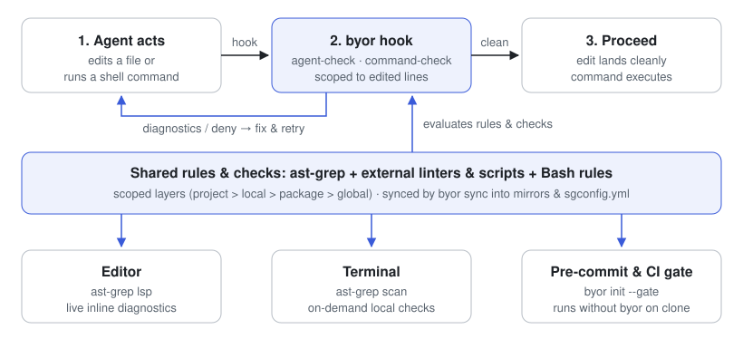

<h1 align="center">
  
</h1>

<p align="center">
  <a href="https://github.com/RyanSaxe/byor/actions/workflows/check.yml"></a>
  <a href="https://pypi.org/project/byor/"></a>
  <a href="https://pypi.org/project/byor/"></a>
  <a href="LICENSE"></a>
</p>

Stop repeating the same code review feedback in `AGENTS.md` and chat. **byor**
(*Build Your Own Rules*) turns your engineering taste, codebase conventions, and
shell safety boundaries into fast mechanical checks that steer AI coding agents
the moment they edit a file or run a command, and enforce the same rules in your
editor, pre-commit, and CI. Tell an agent a preference once; byor enforces it
everywhere.

<picture>
  <source media="(prefers-color-scheme: dark)" srcset="docs/assets/overview-dark.svg">
  
</picture>

- **One rule, four surfaces.** Enforce rules across
  [`ast-grep lsp`](https://ast-grep.github.io/guide/tools/editors.html),
  `ast-grep scan`, pre-commit and CI (`byor init --gate`), and live AI agent
  hooks (Claude Code, Codex, Copilot CLI, Antigravity, OpenCode, Pi).
- **Three check kinds.** Combine `ast-grep` YAML rules for code shape, external
  linters or custom scripts under `checks`, and `language: Bash` command rules
  (plus `command_checks`) that intercept shell commands before they run.
- **Scoped, self-healing sync.** Layer rules across
  `project > local > package > global`. Mirrors stay current automatically
  across repos and git worktrees, while fresh clones lint committed rules with
  plain `ast-grep` and no byor installed.

You rarely write YAML by hand: `byor install` ships a cross-agent `byor` skill
so you state a preference in plain language and your agent drafts, confirms,
adds, and verifies the rule.

## Quick start

Requires Python 3.11+ and [uv](https://docs.astral.sh/uv/).

```sh
uv tool install byor --with-executables-from ast-grep-cli   # install byor and ast-grep on PATH
byor install                                               # wire global rules, agent hooks, and skill
byor init                                                  # initialize rules in the current repository
byor doctor                                                # verify machine and repository health
byor list                                                  # show active rules and checks with origins
ast-grep scan                                              # scan the repository directly
```

See [Install](docs/getting-started/install.md) for setup details and
[Harnesses](docs/reference/harnesses.md) for per-agent hook paths. Browse
CI-tested starter rules in [examples/](examples/README.md), or see
[RyanSaxe/dotfiles `config/byor`](https://github.com/RyanSaxe/dotfiles/tree/main/config/byor)
for a full personal setup (global command safety, multi-language post-edit
linters, and opt-in `craft`, `python`, and `web` packages).

## Documentation

| Page | Topic |
| --- | --- |
| [Install](docs/getting-started/install.md) | Requirements, machine install, agent onboarding, and repository init |
| [Architecture](docs/concepts/architecture.md) | Scopes, precedence, copies vs symlinks, self-healing, state, and worktrees |
| [Agent loop](docs/concepts/agent-loop.md) | Post-edit diagnostics, line scoping, pre-command gate, and rule-capture skill |
| [Authoring rules](docs/guides/authoring-rules.md) | AST rules, exceptions, command rules, extra checks, and check scripts |
| [Packages and profiles](docs/guides/packages-and-profiles.md) | Exclusions, profiles, opt-in packages, promotion, and dotfiles example |
| [Team gates and private mode](docs/guides/team-gates-and-private-mode.md) | Committed CI and pre-commit gates, vendoring, git shims, and private mode |
| [CLI reference](docs/reference/cli.md) | Subcommands, flags, defaults, and exit codes |
| [Configuration reference](docs/reference/configuration.md) | File locations and schemas for global, repo, local, state, and rule YAML |
| [Harnesses](docs/reference/harnesses.md) | Per-agent hook paths, trust steps, ownership markers, and skill discovery |
| [Examples](examples/README.md) | CI-tested starter rules, command rules, check scripts, and real-world setup |
| [Contributing](docs/contributing/README.md) | Development setup, static checks, test suite, and package layout |

## License

Apache 2.0. See [LICENSE](LICENSE).
