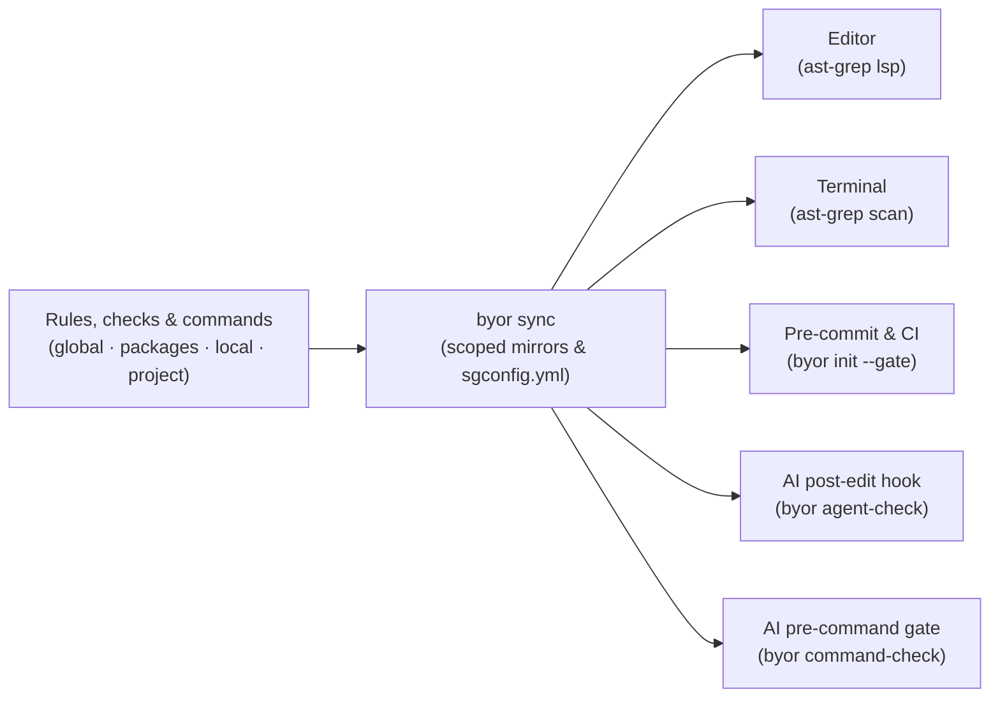

<h1 align="center">
  
</h1>

<p align="center">
  <a href="https://github.com/RyanSaxe/byor/actions/workflows/check.yml"></a>
  <a href="https://pypi.org/project/byor/"></a>
  <a href="https://pypi.org/project/byor/"></a>
  <a href="LICENSE"></a>
</p>

byor enforces the code and command conventions that general linters leave out,
running them in your editor, terminal, CI, and inside your AI coding agent's
loop. Prose guidelines in `AGENTS.md` or `CLAUDE.md` drift out of context; byor
turns durable preferences into mechanical checks that feed exact corrections
back the moment an agent writes violating code or runs a disallowed command.



## The problem and approach

General linters cover universal bugs and style, while team conventions,
architecture boundaries, and personal standards end up buried in markdown files
that coding agents routinely ignore.

- **One rule, four surfaces.** Write a rule once and enforce it in your editor
  ([`ast-grep lsp`](https://ast-grep.github.io/guide/tools/editors.html)), your
  terminal (`ast-grep scan`), pre-commit and CI (`byor init --gate`), and your
  AI agent's edit and command hooks.
- **Three enforcement kinds.** Combine `ast-grep` YAML rules for code shape,
  external linters, type checkers, or custom scripts under `checks`, and
  `language: Bash` command rules (plus `command_checks`) that intercept shell
  commands before they run.
- **Scoped, self-healing sync.** Organize rules across `project`, `local`,
  `package`, and `global` scopes with predictable precedence (`project` >
  `local` > `package` > `global`). Mirrors stay current automatically across
  repositories and git worktrees, while fresh clones run committed rules with
  plain `ast-grep` and zero byor installed.

## Example

Ban one-line pass-through wrappers with a standard `ast-grep` rule plus a
`metadata.byor.agent_prompt` instruction:

```yaml
# .byor/rules/project/no-routing-functions.yml (simplified; full version in examples/)
id: no-routing-functions
language: Python
severity: warning
message: A function whose only job is forwarding a call.
rule:
  kind: function_definition
  has:
    field: body
    has:
      kind: return_statement
      pattern: return $CALLEE($$$ARGS)
      all:
        - nthChild: 1
        - nthChild: { position: 1, reverse: true }
metadata:
  byor:
    agent_prompt: >
      Call the implementation directly, or give the function real behavior.
      Do not keep a pure pass-through wrapper.
```

You rarely write rules by hand. `byor install` ships a cross-agent `byor` skill
so you can state a preference in plain language and your agent drafts, confirms,
adds, and verifies the rule.

## Quick start

byor requires Python 3.11+ and [uv](https://docs.astral.sh/uv/).

```sh
uv tool install byor --with-executables-from ast-grep-cli   # install byor and put ast-grep on PATH
byor install                                               # wire editor + agent integrations (once per machine)
byor init                                                  # initialize rules in the current repository
byor doctor                                                # verify machine and repository health
byor list                                                  # show active rules and checks with origins
ast-grep scan                                              # scan the repository directly
```

See [Install](docs/getting-started/install.md) for setup details and onboarding
via your agent. For a complete real-world personal configuration, see
[RyanSaxe/dotfiles `config/byor`](https://github.com/RyanSaxe/dotfiles/tree/main/config/byor)
(global command safety rules, a read-only multi-language linter runner, and
opt-in `craft`, `python`, and `web` design-craft packages).

## Supported AI agents

| Agent | Post-edit hook | Pre-command gate |
| --- | --- | --- |
| Claude Code | `PostToolUse` | `PreToolUse` |
| Codex | `PostToolUse` | `PreToolUse` |
| Copilot CLI | `postToolUse` | `preToolUse` |
| Antigravity | `PostInvocation` | `PreToolUse` |
| OpenCode | TypeScript plugin (v1 & v2) | Not yet |
| Pi | TypeScript extension | Not yet |

Cursor exposes no reliable post-edit hook, so byor omits it. See
[Harnesses](docs/reference/harnesses.md) for per-agent hook paths, trust steps,
and skill discovery.

## Documentation

| Page | Topic |
| --- | --- |
| [Install](docs/getting-started/install.md) | Requirements, machine install, agent setup, and first repository |
| [Architecture](docs/concepts/architecture.md) | Scopes, precedence, copies vs symlinks, self-healing, state, and worktrees |
| [Agent loop](docs/concepts/agent-loop.md) | Post-edit diagnostics, line scoping, pre-command gate, and rule-capture skill |
| [Authoring rules](docs/guides/authoring-rules.md) | AST rules, exceptions, command rules, extra checks, and check scripts |
| [Packages and profiles](docs/guides/packages-and-profiles.md) | Exclusions, profiles, opt-in packages, promotion, and real-world dotfiles setup |
| [Team gates and private mode](docs/guides/team-gates-and-private-mode.md) | Committed CI and pre-commit gates, script vendoring, git shims, and private mode |
| [CLI reference](docs/reference/cli.md) | Every subcommand, flag, default, and exit code |
| [Configuration reference](docs/reference/configuration.md) | File locations and schemas for global, repo, local, state, and rule YAML |
| [Harnesses](docs/reference/harnesses.md) | Per-agent hook configurations, ownership markers, and skill distribution |
| [Examples](examples/README.md) | CI-tested starter rules, command rules, check scripts, and real-world setup |
| [Contributing](docs/contributing/README.md) | Development setup, static checks, test suite, and package layout |

## License

Apache 2.0. See [LICENSE](LICENSE).
