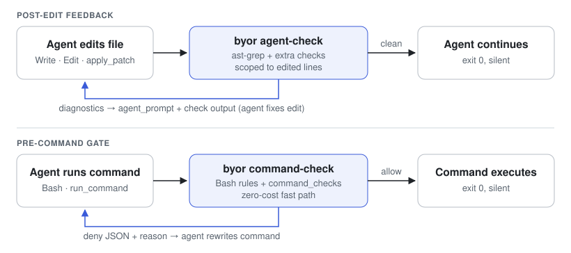

# Agent loop

Two hooks enforce rules inside an AI coding agent's active loop: a post-edit
hook checks each code change as it lands, and a pre-command gate checks each
shell command before it runs.

<picture>
  <source media="(prefers-color-scheme: dark)" srcset="../assets/agent-loop-dark.svg">
  
</picture>

byor writes no `CLAUDE.md` or `AGENTS.md` prose; harnesses load the bundled
`byor` skill via `SKILL.md` and run hooks automatically.

## Post-edit feedback (`agent-check`)

```sh
byor agent-check --scope diff --files src/example.py   # OpenCode / Pi / manual
byor agent-check --stdin-hook claude-code              # Claude Code / Codex / Copilot / Antigravity
```

`agent-check` runs
`ast-grep scan --json=compact --include-metadata --color never`, maps each match
to `metadata.byor.agent_prompt` (falling back to `message`), and runs matching
extra `checks`.

### Line scoping

`--scope` filters `ast-grep` matches to lines the agent touched:

| Scope | Lines included | Default for |
| --- | --- | --- |
| `edit` | Lines matching hook edit text; falls back to `diff`, then `file` | `--stdin-hook` |
| `diff` | Uncommitted `git diff HEAD` lines (untracked files fully in scope; falls back to `file`) | OpenCode, Pi |
| `file` | Entire target files (or whole repo when `--files` is omitted) | CLI |

Deleted files are skipped silently under `edit` and `diff`.

### Output formats and token budget

Findings group by file, sorted by line, rule ID, and column (hook mode prefixes
`BYOR found N issues in AI-written code.`):

```text
BYOR found 1 issue.

src/example.py:3:8
Rule: python.no-requests
Severity: error
Message: This codebase uses httpx, not requests.
Code:
  3 | import requests

Instruction:
Use httpx instead. For simple calls the API is the same (httpx.get, httpx.post); for anything repeated, use an httpx.Client or httpx.AsyncClient with an explicit timeout. Do not add requests to the dependencies.
```

- **Concise output:** Pass `--concise` or set `output.concise: true` in
  `~/.config/byor/config.yml` to drop the code snippet and redundant `Message`
  line.
- **Diagnostic cap:** Set `output.max_diagnostics: N` to cap rendered findings
  per hook turn (default unlimited).
- **JSON output:** `--format json` emits `{"issues": [...]}` (plus `"checks"` on
  check failure) with 1-based positions and repo-relative paths, unaffected by
  `concise` or `max_diagnostics`.

### Exit codes and fail-open behavior

| Mode | Clean | Findings | Error |
| --- | --- | --- | --- |
| CLI (`--files` / whole repo) | `0` | `2` | `1` |
| `--stdin-hook claude-code` | `0` | `2` (stderr via `>&2`) | `0` (fail-open) |
| `--stdin-hook codex\|copilot\|antigravity` | `0` | `0` (JSON on stdout) | `0` (fail-open) |

Hook mode resolves the repository from each edited file (stopping at the nearest
`.git` or `.byor/config.yml`) and groups batched edits (Antigravity
`PostInvocation`, Codex `apply_patch`) by repo. Uninitialized repos scan against
`~/sgconfig.yml` and global `checks`. Internal errors always exit `0` so a
broken rule never stalls a session; run `byor doctor` to inspect them.

## Pre-command gate (`command-check`)

Intercepts shell commands before execution on Claude Code, Codex, Copilot CLI,
and Antigravity (OpenCode and Pi have post-edit plugins only):

```sh
byor command-check --stdin-hook claude-code
byor command-check --command 'pip install requests'   # manual test: exit 2 on match
```

Hook mode parses the pending command and working directory from stdin, evaluates
`language: Bash` command rules and `command_checks`, and replies with the
harness's deny JSON containing `agent_prompt`.

- **Fail-open exit `0`.** Hook mode always exits `0`: approvals print nothing,
  denials print JSON on stdout, and broken rules fail silently (`byor doctor`
  catches them).
- **Zero-cost fast path.** Exits before spawning `ast-grep` or scripts when no
  command rules or `command_checks` apply.
- **Any match denies.** Command rules ignore severity thresholds.
- **Script escape hatch.** `command_checks` receive the command on stdin; any
  nonzero exit denies with the script's output. Hanging scripts are terminated
  and skipped.
- **Steering, not a sandbox.** Rules parse Bash syntax, so quoted strings like
  `sh -c "pip install x"` pass by design. Use harness permissions for security
  boundaries.

## The `byor` rule-capture skill

`byor install` renders a bundled skill (`SKILL.md` + `references/`) for every
supported harness:

1. **Capture (default).** State a durable, mechanically checkable preference
   ("never use X", "use uv, not pip"). The agent chooses the mechanism
   (`ast-grep`, command rule, linter, or script), inspects tags via
   `byor list --scope all --tags`, drafts and confirms the rule (with exception
   policy), adds it via `byor add`, and proves it fires. Non-mechanical
   preferences are redirected to `AGENTS.md` or `CLAUDE.md`.
2. **Setup.** Say "set up byor" to run `byor doctor`, optionally run
   `byor init`, and import checkable rules from existing instruction files.

See [Harnesses](../reference/harnesses.md#skill) for skill paths and self-heal.
