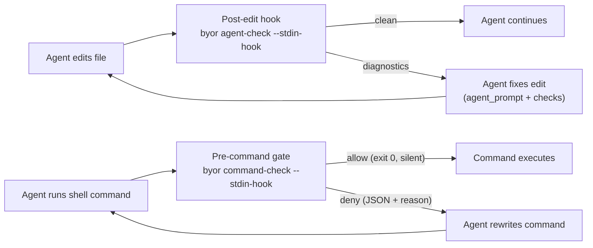

# Agent loop

byor delivers diagnostics inside an AI coding agent's active loop instead of
waiting for a post-hoc review pass. Two hooks close the loop: a post-edit hook
checks each code change as it lands, and a pre-command gate checks each shell
command before it executes.



byor writes no `CLAUDE.md` or `AGENTS.md` prose. Harnesses discover the bundled
`byor` skill via the cross-agent `SKILL.md` standard and invoke the hooks
automatically.

## Post-edit feedback (`agent-check`)

Every post-edit integration runs `byor agent-check`, either via
`--stdin-hook HARNESS` (Claude Code, Codex, Copilot CLI, Antigravity) or via
`--scope diff --files <file>` (OpenCode, Pi):

```sh
byor agent-check --scope diff --files src/example.py
byor agent-check --stdin-hook claude-code
```

`agent-check` runs
`ast-grep scan --json=compact --include-metadata --color never`, maps each match
to `metadata.byor.agent_prompt` (falling back to `message`), and runs any
configured extra `checks` matching the in-scope files.

### Line scoping

`--scope` filters `ast-grep` matches to lines overlapping the active scope so an
agent sees only issues it touched:

| Scope | Lines included | Default for |
| --- | --- | --- |
| `edit` | Lines matching the edit text from the hook payload; falls back to `diff`, then `file` | `--stdin-hook` |
| `diff` | Uncommitted `git diff HEAD` lines (untracked files are fully in scope; falls back to `file` without git history) | OpenCode and Pi plugins |
| `file` | Every line in the target files (or the whole repository when `--files` is omitted) | CLI `--files` / no args |

Under `edit` and `diff` scope, files deleted on disk are skipped silently.

### Output formats and token budget

Default text output groups findings by file, sorted by line, rule ID, and
column:

```text
BYOR found 1 issue.

src/example.py:3:9
Rule: python.no-typing-cast
Severity: warning
Message: Avoid typing.cast in Python code.
Code:
  3 | value = cast(int, "3")

Instruction:
Do not use typing.cast here. Fix the type by narrowing, changing the signature, introducing a protocol, or restructuring the value flow.
```

In hook mode, the header reads `BYOR found N issues in AI-written code.`

- **Concise output:** Pass `--concise` or set `output.concise: true` in
  `~/.config/byor/config.yml` to drop the code snippet and redundant `Message`
  line, leaving one location header plus the fix instruction.
- **Diagnostic cap:** Set `output.max_diagnostics: N` in
  `~/.config/byor/config.yml` to render at most `N` findings per hook turn and
  append `... and M more not shown (raise output.max_diagnostics).` Default is
  unlimited.
- **JSON output:** `--format json` emits `{"issues": [...]}` (plus `"checks"`
  when extra checks fail) with 1-based line and column positions and
  repo-relative paths. JSON output is unaffected by `output.concise` and
  `output.max_diagnostics`.

### Exit codes and fail-open behavior

| Mode | Clean | Findings | Error |
| --- | --- | --- | --- |
| CLI (`--files` / whole repo) | `0` | `2` | `1` |
| `--stdin-hook claude-code` | `0` | `2` (feedback on stderr via `>&2`) | `0` (fail-open, breadcrumb on stderr) |
| `--stdin-hook codex\|copilot\|antigravity` | `0` | `0` (JSON feedback envelope on stdout) | `0` (fail-open, breadcrumb on stderr) |

Hook mode resolves the repository from each edited file rather than the
session's working directory, stopping at the nearest ancestor containing `.git`
or `.byor/config.yml`. Batched hooks (Antigravity `PostInvocation`, Codex
`apply_patch`) group edits by repository. In an uninitialized repository, hook
mode scans against `~/sgconfig.yml` and global `checks`, staying silent when
neither exists.

Internal errors in hook mode always fail open (exit `0`) so a byor bug or broken
config never stalls an agent session. Run `byor doctor` to diagnose silent hook
failures.

## Pre-command gate (`command-check`)

The pre-command gate intercepts shell commands before an agent executes them on
Claude Code, Codex, Copilot CLI, and Antigravity:

```sh
byor command-check --stdin-hook claude-code
byor command-check --command 'pip install requests'   # manual test: exits 2 on match
```

Hook mode parses the pending command and working directory from stdin, matches
the command against effective `language: Bash` command rules and
`command_checks`, and replies with the harness's deny JSON containing the rule's
`agent_prompt` so the agent rewrites and reruns the command.

Key properties:

- **Fail-open exit `0`.** Every harness exits `0` in hook mode; denials are
  explicit JSON permission decisions on stdout, and approvals print nothing. A
  broken command rule disables the gate silently; `byor doctor` catches and
  reports it.
- **Zero-cost fast path.** If no command rules or `command_checks` apply to the
  repository, the hook exits before spawning `ast-grep` or any subprocess.
- **Any match denies.** Command rules have no severity threshold because they
  exist to redirect specific commands.
- **Script escape hatch.** `command_checks` pipe the candidate command to a
  script's stdin; any nonzero exit denies the command using the script's output
  as the correction. Hanging scripts are terminated and skipped.
- **Steering, not a sandbox.** Rules parse commands as Bash syntax, so quoted
  strings like `sh -c "pip install x"` pass by design. Treat the gate as
  guidance; rely on the harness permission system for security boundaries.

OpenCode and Pi currently provide post-edit plugins only.

## The `byor` rule-capture skill

`byor install` renders a bundled skill (`SKILL.md` + `references/`) for every
supported harness. It has two workflows:

1. **Capture (default).** When you express a durable, mechanically checkable
   preference about code or shell commands ("never use X", "use uv, not pip"),
   the agent picks the right mechanism (`ast-grep` rule, command rule, linter
   config, or check script), inspects existing tags with
   `byor list --scope all --tags`, drafts the rule, proposes a scope, confirms
   in one question (including exception policy), adds it via `byor add`, and
   proves it fires against a test snippet. Preferences no mechanical check can
   express are declined with a pointer to `AGENTS.md` or `CLAUDE.md`.
2. **Setup.** Say "set up byor" to verify the installation with `byor doctor`,
   initialize the repository if desired, and optionally import mechanically
   checkable rules from existing instruction files (`CLAUDE.md`, `AGENTS.md`,
   `copilot-instructions.md`).

See [Harnesses](../reference/harnesses.md#skill) for where the skill files live
and how self-heal keeps them current.
