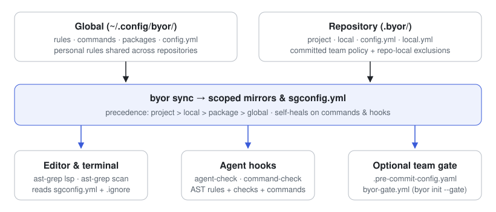

# Architecture

byor keeps rule resolution identical across editors, terminals, CI, and AI
agents while letting fresh clones lint committed rules with plain `ast-grep` and
no byor installed.

## Data flow

<picture>
  <source media="(prefers-color-scheme: dark)" srcset="../assets/architecture-dark.svg">
  
</picture>

## Scopes and precedence

Rules live in four scopes. Command rules mirror the same four scopes under
`.byor/commands/` and `~/.config/byor/commands/`.

| Scope | File rules | Command rules | Shared with |
| --- | --- | --- | --- |
| `project` | `.byor/rules/project/` | `.byor/commands/project/` | Team (committed) |
| `local` | `.byor/rules/personal/local/` | `.byor/commands/personal/local/` | You, this repo |
| `package` | `.byor/rules/personal/packages/<name>/` | `.byor/commands/personal/packages/<name>/` | Opt-in from `~/.config/byor/packages/` |
| `global` | `~/.config/byor/rules/` (canonical) | `~/.config/byor/commands/` (canonical) | You, every repo |

Precedence is uniform for rules, command rules, and checks:
`project > local > package > global`. Higher scopes win silently during sync;
ambiguous conflicts error:

| Conflict | Behavior |
| --- | --- |
| Duplicate ID within `project`, `local`, or canonical `global` | Error |
| `project` or `local` ID matches `global` or `package` ID | Higher scope wins; sync skips the loser |
| `package` ID matches `global` ID | Package wins; sync skips global |
| `project` ID matches `local` ID | Error (use a distinct local ID) |
| Two installed packages share an ID | Error (`byor package add` rolls back) |

Subdirectories under any scope (such as `rules/python/no-cast.yml`) are
preserved in mirrors.

## Why copies, not symlinks

Sync copies the enabled subset of `~/.config/byor/rules/` and
`~/.config/byor/packages/<name>/` into `.byor/rules/personal/{global,packages}/`
instead of symlinking:

- **Per-repo overrides.** A project rule, local rule, package, or exclusion can
  suppress one global ID without affecting other repositories.
- **Zero-byor fresh clones.** Tracked `.gitkeep` and `.ignore` files keep the
  layout valid on `git clone` so `ast-grep scan` works without byor.
- **`ast-grep` symlink limits.** `ast-grep` follows a symlinked top-level
  `ruleDirs` folder, but skips symlinked rule files and symlinked child
  directories inside it, and rejects globs in `ruleDirs`.

Uninitialized repos scan via `~/sgconfig.yml`, so link the whole
`~/.config/byor/rules/` folder (not individual files) if you manage rules from a
dotfiles repo. `byor doctor` flags individual symlinked global rules and
dangling symlinks. When updating a symlinked config such as
`~/.claude/settings.json`, byor writes through the link and never overwrites
read-only files.

## Mirrors and `.ignore` visibility

`.byor/{rules,commands}/personal/{global,packages}/` are generated artifacts
owned by byor. Sync overwrites changed YAML files, deletes strays, prunes empty
directories, and preserves non-YAML files like `.gitkeep`. Staleness is computed
directly against disk with no sync state file.

`byor init` git-ignores personal YAML files so `git status` stays clean. Because
`ast-grep` respects `.gitignore`, `byor init` writes a tracked `.ignore` file in
each personal rule directory (and `project/` under `--private`):

```text
!*.yml
!*.yaml
```

Git ignores `.ignore`; `ast-grep` reads it to un-ignore the rule files. Sync
restores missing `.ignore` files, and `byor doctor` verifies visibility.

## Self-healing

Mirrors stay current without manual syncing:

- **Repo commands** check staleness first and silently refresh mirrors, outdated
  ignore blocks, and owned gate files, printing one stderr line when changed.
- **Agent hooks** (`--stdin-hook`) heal silently before scanning so out-of-band
  rule changes apply on the next edit or command.
- **Exceptions:** `sync --check` exits `3` without writing; `init`, `profile`,
  and `package` sync themselves; `disable`, `enable`, and `hook` skip repo
  healing; `doctor` is read-only.

`byor init` registers repos in `~/.local/state/byor/repos.yml` (skip with
`--no-register`). Run `byor sync --all` to update every registered repo and its
worktrees (`--prune` drops missing paths). Git `post-merge` and `post-checkout`
shims leave tracked `.gitignore` untouched so branch switches never dirty the
tree.

## Settings vs machine state

| Directory | Contents | Owner |
| --- | --- | --- |
| `~/.config/byor/` (`$XDG_CONFIG_HOME/byor`) | `config.yml`, `rules/`, `commands/`, `packages/`, `scripts/` | You (dotfiles-safe; byor never writes `config.yml`) |
| `~/.local/state/byor/` (`$XDG_STATE_HOME/byor`) | `state.yml` (agents, disabled paths), `repos.yml` | byor (serialized with a `.lock` file) |

On upgrade from older versions that stored state under `~/.config/byor/`, the
first command copies entries once into `~/.local/state/byor/`, writes
`.moved-from-config`, and leaves the old files for you to remove (`byor doctor`
flags leftovers under `legacy_state`).

## Git worktrees

A new `git worktree add` checkout lacks git-ignored `.byor/local.yml`, mirrors,
and (under `--private`) `.byor/` and `sgconfig.yml`. On the first byor command
or hook in a linked worktree, byor finds the main checkout via `.git`, copies
ignored byor files, and syncs:

- **Ignored files only.** Copies only files ignored by git in both checkouts and
  never overwrites existing files, keeping `git status` clean.
- **Atomic and concurrency-safe.** `.byor/local.yml` is written last as the
  completion marker; partial copies are cleaned up and retried, and concurrent
  hooks wait for the copy to finish.
- **Optional full ignored copy.** Set `worktrees.copy_ignored: true` in
  `~/.config/byor/config.yml` to also copy other ignored files (such as `.env`)
  after byor's own files; concurrent hooks wait only for byor's fast copy.
- **Registry and disabling.** Linked worktrees are reached via their main
  checkout during `byor sync --all` and inherit its `byor disable` status.
  `doctor` and `sync --check` never copy and instead prompt you to run
  `byor sync`.
