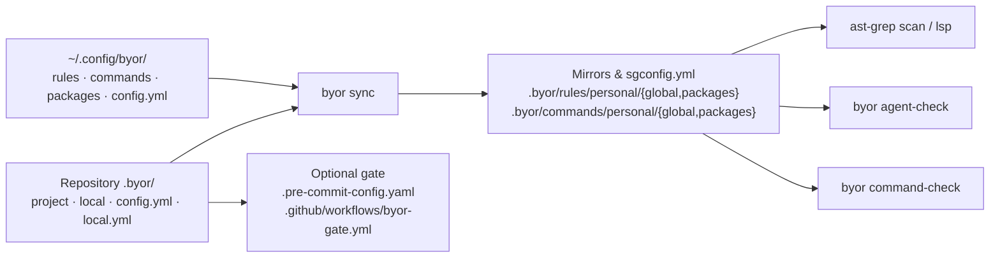

# Architecture

byor keeps rule resolution identical across editors, terminals, CI, and AI
agents while ensuring a fresh clone can lint with plain `ast-grep` and no byor
installed.

## Data flow



## Scopes and precedence

Rules live in four scopes. Command rules mirror the same four scopes under
`.byor/commands/` and `~/.config/byor/commands/`.

| Scope | File rules directory | Command rules directory | Shared with |
| --- | --- | --- | --- |
| `project` | `.byor/rules/project/` | `.byor/commands/project/` | Team (committed) |
| `local` | `.byor/rules/personal/local/` | `.byor/commands/personal/local/` | You, this repo |
| `package` | `.byor/rules/personal/packages/<name>/` | `.byor/commands/personal/packages/<name>/` | Opt-in from `~/.config/byor/packages/` |
| `global` | `~/.config/byor/rules/` (canonical) | `~/.config/byor/commands/` (canonical) | You, every repo |

Precedence is uniform for rules, command rules, and checks:

```text
project  >  local  >  package  >  global
```

When a higher-precedence scope owns an ID, sync skips the lower-precedence copy
without error. Conflicts that `ast-grep` cannot disambiguate are hard errors:

| Conflict | Behavior |
| --- | --- |
| Duplicate ID within `project`, within `local`, or within canonical `global` | Error |
| `project` or `local` ID matches `global` or `package` ID | Higher scope wins; sync skips the losing copy |
| `package` ID matches `global` ID | Package wins; sync skips the global copy |
| `project` ID matches `local` ID | Error (give a local variant a distinct ID) |
| Two installed packages share an ID | Error (`byor package add` rolls back; drop one with `byor package remove`) |

Organize rules in subdirectories by language or topic (for example,
`rules/python/no-typing-cast.yml`). Sync preserves relative paths inside the
mirrors.

## Why copies, not symlinks

Canonical global rules live in `~/.config/byor/rules/` and package rules live in
`~/.config/byor/packages/<name>/`. Sync copies the enabled subset into each
repository's `.byor/rules/personal/{global,packages}/` rather than symlinking:

- **Per-repo overrides and exclusions.** Each repository owns its mirror, so a
  project rule, local rule, package rule, or exclusion can suppress one global
  ID without touching other repositories.
- **Zero-byor fresh clones.** Tracked `.gitkeep` and `.ignore` files keep the
  directory layout valid immediately on `git clone`, so `ast-grep scan` runs
  committed project rules with no byor installation.
- **`ast-grep` symlink limits.** `ast-grep` loads a symlinked top-level folder
  in `ruleDirs`, but skips symlinked rule files and symlinked child directories
  inside a rule directory, and `ruleDirs` does not accept globs.

Because uninitialized repositories scan through `~/sgconfig.yml`, a symlinked
rule file directly inside `~/.config/byor/rules/` is skipped there too. Link the
whole `rules/` folder instead (for example from a dotfiles checkout), or copy
the files. `byor doctor` flags individual symlinked global rule files.

When byor updates a file you symlinked, such as `~/.claude/settings.json`, it
writes through the link to the target. byor never replaces a read-only file
(linked or not): explicit commands fail naming the file, and self-heal reports a
per-agent warning. Dangling symlinks are reported by `byor install` and
`byor doctor`.

## Mirrors and `.ignore` visibility

`.byor/rules/personal/global/` and `.byor/rules/personal/packages/` (and their
`.byor/commands/personal/` counterparts) are generated build artifacts wholly
owned by byor. Sync mirrors them wholesale: updated files are overwritten, stray
YAML files are deleted, empty directories are pruned, and non-YAML files like
`.gitkeep` are preserved. There is no sync state file; staleness is derived by
comparing disk contents against the desired mirror plan.

`byor init` git-ignores personal rule YAML files so local rules and generated
mirrors never appear in `git status`. Because `ast-grep` respects `.gitignore`,
git-ignoring those files would hide them from `ast-grep scan` and
`ast-grep lsp`. To keep them visible to `ast-grep` alone, `byor init` writes a
tracked `.ignore` file into each personal rule directory (and into `project/`
under `--private`):

```text
!*.yml
!*.yaml
```

Git ignores `.ignore` files, while `ast-grep` reads them to un-ignore the rule
files. Sync restores missing `.ignore` files inside mirrors, and `byor doctor`
checks visibility on every personal directory.

## Self-healing

Copies can drift when you pull dotfiles or switch branches. Staleness is
self-healing rather than enforced by user discipline:

- **Repo commands** run a fast staleness check before executing and silently
  sync mirrors, refresh outdated byor ignore blocks, and regenerate owned gate
  files when needed, printing one line to stderr only when something changed.
- **Agent hooks** (`byor agent-check --stdin-hook` and
  `byor command-check --stdin-hook`) heal the repo silently before scanning so
  rules added out of band take effect on the next edit or command.
- **Exceptions:** `byor sync` runs sync as its body; `byor sync --check` reports
  staleness and exits `3` without writing; `byor init`, `byor profile`, and
  `byor package` handle their own syncing; `byor disable`, `byor enable`, and
  `byor hook` skip repo healing; `byor doctor` is read-only.

`byor init` registers each repository in `~/.local/state/byor/repos.yml` (skip
with `--no-register`). Use `byor sync --all` to update every registered
repository and its worktrees, and `byor sync --all --prune` to drop entries
whose directories no longer exist.

When git runs `byor sync` via the `post-merge` or `post-checkout` shims, byor
leaves tracked `.gitignore` files untouched so switching to an older branch
never dirties the working tree. The next interactive byor command updates an
outdated ignore block.

## Settings vs machine state

byor separates user-authored configuration from machine state it writes itself:

| Directory | Contents | Owner |
| --- | --- | --- |
| `~/.config/byor/` (`$XDG_CONFIG_HOME/byor`) | `config.yml`, `rules/`, `commands/`, `packages/`, `scripts/` | You. Safe to keep in a dotfiles repo; byor never writes `config.yml`. |
| `~/.local/state/byor/` (`$XDG_STATE_HOME/byor`) | `state.yml` (installed agents, disabled paths) and `repos.yml` | byor (`install`, `hook`, `disable`, `enable`, `init`, self-heal). |

Concurrent writes to `state.yml` and `repos.yml` serialize through a `.lock`
file. On upgrade from older byor versions that stored `ai.agents`,
`disabled_repos`, or `repos.yml` under `~/.config/byor/`, the first command
copies them once into `~/.local/state/byor/`, writes `.moved-from-config`, and
leaves the old files intact for you to remove (`byor doctor` flags any leftover
entries under `legacy_state`).

## Git worktrees

`git worktree add` checks out only tracked files, so a new worktree starts
without `.byor/local.yml`, generated mirrors, or (under `--private`) any of
`.byor/` and `sgconfig.yml`.

On the first byor command or agent hook in a linked worktree, byor locates the
main checkout through the worktree's `.git` file, copies ignored byor files from
the main checkout, and syncs:

```text
byor: copied 17 byor files from the main checkout /home/me/project
```

Key guarantees:

- **Only ignored files are copied.** byor copies a file only when git ignores it
  in both the main checkout and the worktree, and never overwrites an existing
  file. Deleted tracked files stay deleted and `git status` stays clean.
- **Atomic marker and concurrency.** `.byor/local.yml` is written last to mark a
  completed copy; a partial failure is cleaned up and retried on the next run.
  Concurrent hooks wait for the first copy to finish.
- **Optional full ignored copy.** Set `worktrees.copy_ignored: true` in
  `~/.config/byor/config.yml` to also copy other git-ignored files (such as
  `.env` or build caches) after byor's own files. Concurrent hooks wait only for
  byor's fast copy, so scanning proceeds immediately while large folders copy.
- **Registry and disabled repos.** Linked worktrees of a byor repo are not added
  to `repos.yml`; `byor sync --all` and global rule edits reach them via their
  main checkout. Worktrees inherit their main checkout's `byor disable` status.
  `byor doctor` and `byor sync --check` never copy and instead prompt you to run
  `byor sync`.
